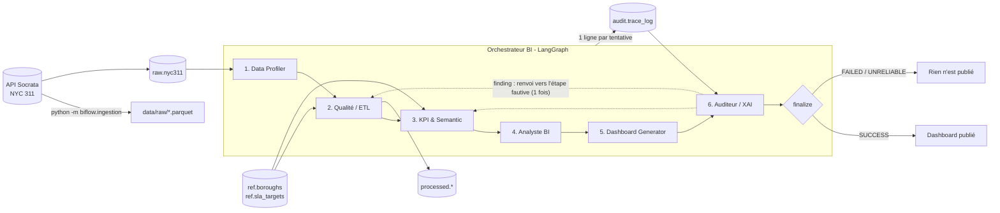

# BIFlow — pipeline BI multi-agents pour le secteur public

Projet étudiant (équipe de 6) : un pipeline BI automatisé et multi-agents, orchestré avec
**LangGraph**, appliqué aux demandes **NYC 311** (NYC Open Data, API Socrata `erm2-nwe9`).

Ce dépôt contient l'**infra + l'orchestrateur** : base PostgreSQL, ingestion, state partagé,
classe de base des agents, traçabilité, validation, gestion des erreurs, boucle de l'Auditeur.
Les 6 agents existent sous forme de **stubs** à remplacer par chaque coéquipier.

---

## Architecture



Fonctionnement de l'orchestrateur (`src/biflow/orchestrator/graph.py`) :

| Mécanisme | Comportement |
|---|---|
| **State partagé** | `PipelineState` (pydantic) : `run_id`, `dataset`, `outputs` par agent, `validations`, `errors`, `history`, `corrections`, `findings`, `status` |
| **Retry** | une étape qui lève une exception **ou** échoue à la validation est relancée `BIFLOW_MAX_RETRIES` fois (défaut 2) |
| **Échec** | après le dernier essai : run `FAILED`, les étapes suivantes ne s'exécutent pas, rien n'est publié |
| **Validation** | après chaque agent : schéma pydantic de la sortie + contrôles métier (`validate()`), ex. colonnes attendues, `rows_out <= rows_in`, KPI dans leur plage |
| **Boucle Auditeur** | si l'Auditeur émet un finding `error`, retour vers l'étape fautive la plus en amont (+ réexécution de l'aval), **une seule fois** (`BIFLOW_MAX_FEEDBACK_ROUNDS`). Si le problème persiste : run `UNRELIABLE`, non publié |
| **Traçabilité** | chaque tentative de chaque étape → une ligne dans `audit.trace_log`, plus une ligne `__run__` de synthèse |

Statuts finaux : `success` (publié) · `failed` · `unreliable`.

---

## Installation

Prérequis : Python 3.11+, Docker Desktop, Git.

```powershell
# 1. Environnement Python + dépendances + fichier .env
python -m venv .venv
.\.venv\Scripts\python -m pip install -e ".[dev]"
Copy-Item .env.example .env        # puis éditer POSTGRES_PASSWORD (et SOCRATA_APP_TOKEN si vous en avez un)

# 2. Base de données (PostgreSQL 16 + Adminer) et création des tables
docker compose up -d --wait
.\.venv\Scripts\python -m biflow.db.init_db
```

Raccourcis : `make <cible>` (Linux/macOS/Git Bash avec make) ou `.\scripts\tasks.ps1 <cible>` (Windows) avec
les cibles `setup`, `up`, `down`, `init-db`, `ingest`, `ingest-small`, `run`, `test`.

**Adminer** (navigateur de la base) : <http://localhost:8081> — Système *PostgreSQL*, serveur `postgres`,
utilisateur/mot de passe/base issus de `.env`.

## Exécution

```powershell
# Ingestion : 12 derniers mois, types "Noise*" et "Street*", plafond 200 000 lignes
.\.venv\Scripts\python -m biflow.ingestion
# Extrait de test rapide
.\.venv\Scripts\python -m biflow.ingestion --max-rows 5000
# Paramètres personnalisés (un type terminé par * = préfixe)
.\.venv\Scripts\python -m biflow.ingestion --start 2026-01-01 --end 2026-03-31 `
    --complaint-types "Noise - Residential" "Street Condition" --max-rows 50000 --format csv

# Pipeline complet
.\.venv\Scripts\python -m biflow.run
.\.venv\Scripts\python -m biflow.run --start 2026-01-01 --end 2026-03-31
.\.venv\Scripts\python -m biflow.run --no-db                                       # sans PostgreSQL
.\.venv\Scripts\python -m biflow.run --simulate-failure quality_etl                # démo retry -> FAILED
.\.venv\Scripts\python -m biflow.run --simulate-audit-flag kpi_semantic            # démo boucle Auditeur
.\.venv\Scripts\python -m biflow.run --simulate-audit-flag kpi_semantic --persistent  # -> UNRELIABLE

# Tests (les tests "db" utilisent la base biflow_test, créée automatiquement)
.\.venv\Scripts\python -m pytest
```

L'ingestion est **rejouable** : upsert sur `unique_key` (une demande déjà présente est mise à jour, par
exemple quand elle passe de *Open* à *Closed*).

## Base de données

| Table | Contenu |
|---|---|
| `raw.nyc311` | demandes brutes (`unique_key` PK, `created_date`, `closed_date`, `agency`, `complaint_type`, `descriptor`, `incident_zip`, `borough`, `status`, `resolution_description`, `latitude`, `longitude`, `ingested_at`) |
| `ref.boroughs` | 5 boroughs ; `population`, `population_year`, `population_source` à compléter |
| `ref.sla_targets` | délai cible (heures) par `complaint_type` — **valeurs PLACEHOLDER** (`is_placeholder = true`, note *TO BE DEFINED*) |
| `audit.trace_log` | une ligne par tentative d'étape : `run_id`, `step`, `attempt`, `status`, `started_at`, `ended_at`, `input_rows`, `output_rows`, `message`, `details` (JSONB) |
| schéma `processed` | vide : réservé aux sorties de l'agent Qualité/ETL |

Le schéma est défini dans `src/biflow/db/models.py` (source de vérité) ; `init_db` est idempotent.
Les dates NYC 311 sont en heure locale de New York (timestamps sans fuseau).

## Structure

```
biflow/
├── docker-compose.yml        PostgreSQL 16 + Adminer
├── pyproject.toml / requirements.txt
├── Makefile, scripts/tasks.ps1
├── .env.example
├── data/{raw,processed,test}/  (ignoré par git)
├── docs/SUMMARY.md
├── notebooks/
├── src/biflow/
│   ├── run.py                CLI : python -m biflow.run
│   ├── common/               config (.env), logging, schéma des colonnes, load_raw_frame()
│   ├── db/                   engine, models (schéma), init_db, loader (upsert)
│   ├── ingestion/            client Socrata + CLI (python -m biflow.ingestion)
│   ├── orchestrator/         state, graph (LangGraph), validation, tracing, report
│   └── agents/               base.py + 1 fichier par agent (stubs) + testing.py
└── tests/
```

---

## Pour les coéquipiers

### Qui modifie quoi

| Agent | Fichier à modifier | Lit dans le state | Produit (`outputs[...]`) |
|---|---|---|---|
| Data Profiler | `src/biflow/agents/data_profiler.py` | `dataset` | `ProfilerOutput` |
| Qualité / ETL | `src/biflow/agents/quality_etl.py` | `dataset`, `outputs["data_profiler"]` | `QualityOutput` (+ table `processed.*`) |
| KPI & Semantic | `src/biflow/agents/kpi_semantic.py` | `outputs["quality_etl"]` | `KPIOutput` |
| Analyste BI | `src/biflow/agents/analyste_bi.py` | `outputs["kpi_semantic"]` | `AnalysisOutput` |
| Dashboard Generator | `src/biflow/agents/dashboard_generator.py` | `outputs["kpi_semantic"]`, `outputs["analyste_bi"]` | `DashboardOutput` |
| Auditeur / XAI | `src/biflow/agents/auditor_xai.py` | tout le state + `audit.trace_log` | `AuditOutput` (+ `findings`) |

Chaque fichier commence par une docstring **« À IMPLÉMENTER »** qui détaille le travail attendu.

### Le contrat d'un agent

```python
class KPISemanticAgent(BaseAgent):
    name = "kpi_semantic"            # NE PAS CHANGER : clé du state, nom du nœud, step dans trace_log
    output_model = KPIOutput         # modèle pydantic de sortie = contrat avec les agents suivants

    def run(self, state: PipelineState) -> KPIOutput:
        etl = state.output("quality_etl")          # sortie de l'étape précédente (dict)
        ...                                        # votre logique
        return KPIOutput(kpis=[...], input_rows=..., output_rows=...)

    def validate(self, output: KPIOutput, state: PipelineState) -> list[Check]:
        return [check_in_range("kpi:x", output.kpis[0].value, 0, 100)]   # contrôles métier
```

Règles :

1. **Ne modifiez pas le state** : retournez seulement votre objet de sortie, l'orchestrateur l'enregistre
   dans `state.outputs[name]` (en dict JSON).
2. **En cas d'erreur, levez une exception** : pas de `try/except` qui avale l'erreur. L'orchestrateur
   relance l'étape, puis marque le run `FAILED`.
3. **Ne mettez pas de DataFrame dans la sortie** : uniquement des valeurs JSON-sérialisables. Les gros
   volumes vont en base (schéma `processed`) et vous renvoyez le nom de la table.
4. **Vous pouvez ajouter des champs** à votre modèle de sortie ; pour **renommer/supprimer** un champ,
   prévenez les agents qui le lisent (tableau ci-dessus).
5. Passez `is_stub=False` (valeur par défaut) quand votre agent est réel : le résumé n'affichera plus `[stub]`.
6. Si l'Auditeur vous renvoie une correction, elle est dans `state.corrections.get(self.name)` : votre
   agent doit en tenir compte lors de sa réexécution.

Champs communs (`AgentOutput`) : `input_rows`, `output_rows` (repris dans `audit.trace_log`), `notes`
(texte libre, repris dans `message`), `is_stub`.

### Lire les données

```python
from biflow.common.data import load_raw_frame
df = load_raw_frame(state.dataset)          # raw.nyc311 filtré sur la fenêtre de dates du run
from biflow.db.engine import get_engine     # pour lire/écrire d'autres tables (SQLAlchemy)
```

### Le logging : rien à faire

`BaseAgent.execute()` écrit automatiquement dans `audit.trace_log`, pour chaque tentative :
statut (`success` / `retry` / `failed`), horodatages, `input_rows` / `output_rows`, `notes`, et dans
`details` : résultats de validation, traceback en cas d'erreur, tour de rétroaction, correction appliquée.
Pour vos logs de debug, utilisez `logging.getLogger(__name__)`.

```sql
SELECT step, attempt, status, input_rows, output_rows, message
FROM audit.trace_log WHERE run_id = '<run_id affiché par biflow.run>' ORDER BY id;
```

### Tester votre agent

```powershell
.\.venv\Scripts\python -m biflow.run                  # tout le pipeline avec votre agent
.\.venv\Scripts\python -m pytest                      # ne doit rien casser
```

Ajoutez vos tests dans `tests/test_<agent>.py`. La fixture `ctx` (`tests/conftest.py`) fournit un
contexte sans délai de retry avec une trace en mémoire ; `clean_db` fournit une base de test vide.

### Workflow Git

Une branche par agent (`feat/kpi-semantic`…), pull request vers `main`, `pytest` vert avant merge.
Ne committez jamais `.env` ni `data/`.
