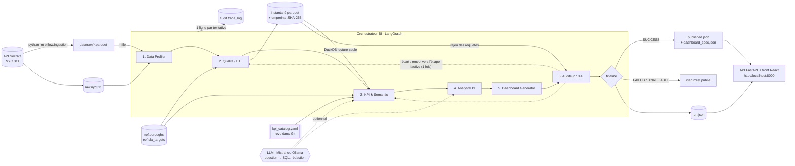

# BIFlow — pipeline BI multi-agents pour le service public

BIFlow transforme des données brutes en **tableau de bord vérifié**. Six agents, orchestrés par
**LangGraph**, profilent les données, les nettoient, calculent les indicateurs en SQL, cherchent les
tendances et les anomalies, choisissent les graphiques, puis un **Auditeur** rejoue chaque requête avant
toute publication. Cas d'usage : les demandes de services publics **NYC 311** (NYC Open Data, API Socrata
`erm2-nwe9`).

Principe : **le LLM comprend et rédige ; le code calcule, vérifie et décide de publier.** Aucun chiffre
publié ne vient du LLM.

| Résultat | Valeur |
|---|---|
| Données réelles traitées | 265 609 demandes, janvier 2023 à septembre 2026 |
| Contrôles d'audit sur le run réel | 53 sur 53 |
| Questions métier bien traduites en SQL (LLM local) | 88 % (objectif ≥ 80 %) |
| Erreurs volontaires bloquées par l'Auditeur | 4 sur 4, rien n'est publié |
| Chiffres inventés dans les insights | 0 |
| Tests automatisés | 95 (dont les 4 scénarios de démonstration) |

Livrables de la validation (dossier [`livrables/`](livrables/)) : présentation, rapport (docx et pdf),
vidéo commentée de 3 min 10.

---

## Sommaire

1. [Démarrage rapide](#1-démarrage-rapide)
2. [L'application web](#2-lapplication-web)
3. [Les 4 scénarios de démonstration](#3-les-4-scénarios-de-démonstration)
4. [Les 6 agents](#4-les-6-agents)
5. [Architecture](#5-architecture)
6. [Installation complète et ligne de commande](#6-installation-complète-et-ligne-de-commande)
7. [Évaluation](#7-évaluation)
8. [Sécurité et RGPD](#8-sécurité-et-rgpd)
9. [Configuration](#9-configuration)
10. [Base de données](#10-base-de-données)
11. [Tests](#11-tests)
12. [Structure du dépôt](#12-structure-du-dépôt)
13. [Limites connues](#13-limites-connues)
14. [Pour les coéquipiers](#14-pour-les-coéquipiers)

---

## 1. Démarrage rapide

Prérequis : **Python 3.11+** et **Node.js 18+** (pour compiler le front une fois). PostgreSQL et le LLM
sont optionnels.

```powershell
python -m venv .venv
.\.venv\Scripts\python -m pip install -e ".[dev]"
Copy-Item .env.example .env

.\scripts\tasks.ps1 web               # compile le front si besoin, puis http://localhost:8000
```

Ouvrir <http://localhost:8000>, page **Scénarios**, choisir un scénario et cliquer sur
**Lancer le scénario**.

Avec le **LLM local** (questions en langage libre, insights rédigés) :

```powershell
ollama pull qwen2.5:7b                # une fois ; Ollama doit tourner
.\scripts\tasks.ps1 web --llm ollama
```

Sans LLM, tout fonctionne avec la **baseline à règles** (plus rapide, mêmes garde-fous). Le bandeau en haut
à droite de l'application indique le mode actif.

L'extrait réel `data/raw/nyc311_2023-01_2026-09_echantillon.parquet` doit être présent (données non
versionnées). Sinon : `python -m biflow.ingestion` (API Socrata) ou
`python -m biflow.ingestion.import_pages <dossier> --name <nom>` (pages déjà téléchargées).

Linux / macOS : `make web` (équivalent de `tasks.ps1`).

---

## 2. L'application web

Front **React** (Vite + TypeScript, `frontend/`) servi par une API **FastAPI** (`src/biflow/api/`). L'API
lance le **vrai pipeline** LangGraph dans un fil d'exécution et suit chaque agent en direct : rien n'est
rejoué ni précalculé.

| Page | Ce qu'on y fait |
|---|---|
| **Scénarios** | lancer un scénario ; les 6 agents sont les stations d'une ligne qui s'allument quand ils travaillent ; une flèche montre le renvoi de l'Auditeur ; journal de l'orchestrateur en français ; un panneau par agent avec ses vraies sorties |
| **Tableau de bord** | le dernier run **publié** : 5 KPI, courbe journalière avec les anomalies, insights avec leurs preuves, ventilations ; « Voir le SQL » sous chaque chiffre |
| **Poser une question** | question en français, traduite en SQL et exécutée en lecture seule sur l'instantané audité ; refus motivé hors périmètre |
| **Audit et provenance** | réserves sur l'échantillon, défauts du Profiler, règles de l'ETL, 53 contrôles de l'Auditeur |
| **Historique** | tous les runs : statut, étapes réussies, nouveaux essais, renvois, audit ; un clic rouvre le run |

Le tableau de bord n'affiche **jamais** un run en échec ou non fiable, et il refuse une spécification
modifiée après l'audit (empreinte SHA-256 vérifiée à chaque affichage).

Routes de l'API :

| Route | Rôle |
|---|---|
| `GET /api/meta` | scénarios, extraits disponibles, LLM actif, questions d'exemple |
| `POST /api/runs` | lance un scénario (`scenario`, `step`, `dataset`, `questions`, `pace_s`) ; un seul run à la fois |
| `GET /api/runs` | historique des runs de `data/processed` |
| `GET /api/runs/{id}/live?since=n` | événements en direct d'un run lancé depuis l'API |
| `GET /api/runs/{id}` | `run.json` complet (sorties des 6 agents) |
| `GET /api/runs/{id}/quarantine` | lignes écartées par Qualité/ETL, avec leur règle |
| `GET /api/published` | dernier run publié et sa spec (empreinte vérifiée) |
| `POST /api/ask` | question sur l'instantané audité du run publié |

L'API n'écoute que sur `127.0.0.1` par défaut. Développement avec rechargement à chaud :

```powershell
.\.venv\Scripts\python -m biflow.api --reload      # API sur :8000
cd frontend; npm install; npm run dev               # front sur http://localhost:5173 (proxy vers l'API)
```

---

## 3. Les 4 scénarios de démonstration

Chaque scénario lance le **vrai pipeline** sur l'extrait choisi. Les pannes et les écarts sont injectés
avec les mêmes options que la ligne de commande ; tout le reste est le comportement normal de
l'orchestrateur. Les quatre scénarios sont aussi des tests automatiques (`tests/test_api.py`).

| # | Scénario | Ce qu'on injecte | Ce que fait l'orchestrateur | Statut final | Publié ? |
|---|---|---|---|---|---|
| 1 | Run nominal | rien | les 6 agents s'enchaînent ; l'Auditeur valide 53/53 contrôles | `success` | oui |
| 2 | Panne d'un agent | l'agent choisi échoue à chaque essai | 3 essais, puis arrêt ; les agents suivants ne tournent pas | `failed` | non |
| 3 | Écart corrigé par l'Auditeur | un écart signalé sur l'étape choisie | renvoi vers l'étape fautive, réexécution de l'aval, second audit réussi | `success` | oui |
| 4 | Écart persistant | l'écart reste après le renvoi | une seule boucle autorisée : run déclaré non fiable | `unreliable` | non, le tableau de bord garde le dernier run validé |

### Scénario 1 — Run nominal

- **Lancer :** page Scénarios, *Run nominal*. En ligne de commande :
  `python -m biflow.run --no-db --file data/raw/nyc311_2023-01_2026-09_echantillon.parquet`
- **Ce qu'on voit :** les stations s'allument une à une ; le journal affiche le résultat de chaque agent :
  - Profiler : 3 types de défaut détectés ;
  - Qualité/ETL : 139 lignes supprimées par des règles tracées et gardées en quarantaine,
    265 470 conservées dans l'instantané `83d3805019db` ;
  - KPI : 5 KPI et 6 ventilations en SQL, réponses aux questions métier ;
  - Analyste : tendance, 24 jours anormaux à l'échelle de la ville, insights avec preuves ;
  - Dashboard : 13 éléments ;
  - Auditeur : 53/53 contrôles, run publié.
- **Résultat :** `success`, le tableau de bord passe sur ce run. Les trois questions par défaut montrent
  les deux cas : une réponse chiffrée (bruit dans le Bronx : 15 443) et un refus motivé (« Pourquoi... » :
  les données ne contiennent pas les causes).
- **Durée :** environ 10 s sans LLM, environ 1 min 30 avec `qwen2.5:7b` (plus 0,6 s par agent si
  « Ralentir pour la présentation » est coché).

### Scénario 2 — Panne d'un agent

- **Lancer :** *Panne d'un agent*, puis choisir l'agent (par défaut Qualité / ETL). En ligne de commande :
  `python -m biflow.run --no-db --simulate-failure quality_etl`
- **Ce qu'on voit :** « Essai 1 échoué… l'orchestrateur relance l'étape », essai 2, puis « Échec définitif à
  l'essai 3 ». La station passe en rouge, les suivantes restent en attente, la ligne se termine sur
  « Bloqué ».
- **Résultat :** `failed`, rien n'est publié. Chaque essai est tracé (`audit.trace_log`, `run.json`).
- **Pourquoi c'est important :** une panne ne produit jamais un tableau de bord partiel.

### Scénario 3 — Écart corrigé par l'Auditeur

- **Lancer :** *Écart corrigé par l'Auditeur*, puis choisir l'étape signalée (par défaut KPI & Semantic).
  En ligne de commande : `python -m biflow.run --no-db --simulate-audit-flag kpi_semantic`
- **Ce qu'on voit :** après le premier audit, une flèche « Renvoi de l'Auditeur vers KPI & Semantic » ;
  l'étape fautive et les suivantes refont leur travail (« 2 passages ») ; le second audit passe (53/53).
  Le panneau de l'Auditeur montre les deux passages.
- **Résultat :** `success`, publié. Le renvoi est gardé dans le journal et dans `run.json`.

### Scénario 4 — Écart persistant

- **Lancer :** *Écart persistant*, puis choisir l'étape. En ligne de commande :
  `python -m biflow.run --no-db --simulate-audit-flag kpi_semantic --persistent`
- **Ce qu'on voit :** même renvoi que le scénario 3, mais le second audit signale encore l'écart ; la ligne
  se termine sur « Bloqué » avec « run déclaré non fiable ».
- **Résultat :** `unreliable`, rien n'est publié. La page Tableau de bord affiche toujours le dernier run
  validé ; l'Historique montre le run « Non fiable ».

### En plus : la question hors périmètre

Page **Poser une question** : « Combien d'agents faut-il recruter ? » est refusée avec la raison (aucune
donnée d'effectifs ni de budget), sans requête ni appel au LLM. Une question avec une adresse, un e-mail ou
un téléphone est masquée avant tout envoi.

Le détail de chaque agent, scénario par scénario (entrées, étapes, sorties, cas d'erreur, critères
d'acceptation), est dans [`docs/SCENARIOS.md`](docs/SCENARIOS.md). Le déroulé minute par minute de la
soutenance est dans [`docs/DEMO.md`](docs/DEMO.md).

---

## 4. Les 6 agents

| # | Agent | Ce que fait le code | Rôle du LLM (optionnel) | Exemple sur les données réelles |
|---|---|---|---|---|
| 1 | **Data Profiler** | types, valeurs nulles, distributions ; défauts typés par colonne (doublon, manquant, mauvais type, format invalide, hors plage, incohérence) | — | 265 609 demandes, 3 types de défaut, dont 1 089 demandes « Closed » sans date de clôture |
| 2 | **Qualité / ETL** | 12 règles tracées, minimisation RGPD (texte libre retiré, coordonnées arrondies à environ 1 km), délai et SLA, **instantané parquet + empreinte SHA-256**, quarantaine | — | 139 lignes supprimées (ex. clôture avant création), 265 470 conservées |
| 3 | **KPI & Semantic** | 5 KPI et 6 ventilations du catalogue `semantic/kpi_catalog.yaml`, exécutés par DuckDB en lecture seule ; requêtes enregistrées ; agrégats de moins de 10 demandes masqués ; refus hors périmètre | **question → SQL**, exécutée dans un bac à sable et comparée à la baseline | 97,7 % de demandes clôturées, délai médian 7,3 h |
| 4 | **Analyste BI** | tendance, anomalies **STL + z-score robuste** (ville et boroughs), type de plainte le plus en hausse ce jour-là (piste, pas une cause) ; chaque insight porte ses preuves | **rédaction** ; un texte qui cite un nombre absent des preuves est rejeté | 24/02/2026 : 460 demandes au lieu d'environ 218, *Snow or Ice* |
| 5 | **Dashboard Generator** | choisit les graphiques par règles et écrit `dashboard_spec.json` (valeurs + `query_ids`) | — | 13 éléments : 5 cartes, 5 barres, 1 courbe, 1 table, 1 bloc texte |
| 6 | **Auditeur / XAI** | empreinte de l'instantané, KPI affiché = résultat enregistré, **rejeu de toutes les requêtes**, recalcul indépendant en pandas, seuil, nombres des insights, empreinte du dashboard ; explication en clair | — (c'est le code qui vérifie) | 53/53 contrôles, run publié |

---

## 5. Architecture



| Mécanisme | Comportement (`src/biflow/orchestrator/graph.py`) |
|---|---|
| **État partagé** | `PipelineState` (pydantic) : `run_id`, `dataset`, sorties par agent, validations, erreurs, historique, corrections, findings, statut |
| **Nouvel essai** | une étape qui lève une exception ou échoue à la validation est relancée `BIFLOW_MAX_RETRIES` fois (2 par défaut) |
| **Échec** | après le dernier essai : run `failed`, les étapes suivantes ne tournent pas, rien n'est publié |
| **Validation** | après chaque agent : schéma pydantic + contrôles métier (`validate()`) |
| **Boucle Auditeur** | un finding `error` renvoie le run vers l'étape fautive la plus en amont (et réexécute l'aval), une seule fois (`BIFLOW_MAX_FEEDBACK_ROUNDS`) ; si l'écart persiste : `unreliable` |
| **Traçabilité** | une ligne par tentative dans `audit.trace_log` (ou en mémoire avec `--no-db`), plus le `run.json` du run |

Choix techniques et options écartées : voir l'étude
[`BIFlow — Architecture et étude comparative des choix techniques.md`](<BIFlow — Architecture et étude comparative des choix techniques.md>).

---

## 6. Installation complète et ligne de commande

PostgreSQL (optionnel : sans base, utiliser `--no-db`) :

```powershell
Copy-Item .env.example .env              # renseigner POSTGRES_PASSWORD (et SOCRATA_APP_TOKEN si disponible)
docker compose up -d --wait              # PostgreSQL 16 + Adminer (http://localhost:8081)
.\.venv\Scripts\python -m biflow.db.init_db
```

Raccourcis : `.\scripts\tasks.ps1 <cible>` (Windows) ou `make <cible>`, avec les cibles `setup`, `up`,
`down`, `init-db`, `ingest`, `ingest-small`, `run`, `evaluate`, `web`, `dashboard`, `demo`, `test`.

```powershell
# Ingestion (12 derniers mois par défaut ; rejouable : upsert sur unique_key)
.\.venv\Scripts\python -m biflow.ingestion
.\.venv\Scripts\python -m biflow.ingestion --max-rows 5000
.\.venv\Scripts\python -m biflow.ingestion.import_pages <dossier raw> --name nyc311_2023-01_2026-09_echantillon `
    --source "NYC Open Data 311 (erm2-nwe9)" --note "Échantillon systématique d'environ 2 % : non probabiliste."

# Pipeline
.\.venv\Scripts\python -m biflow.run                                   # depuis PostgreSQL
.\.venv\Scripts\python -m biflow.run --no-db                           # dernier extrait de data/raw
.\.venv\Scripts\python -m biflow.run --file <extrait> --question "Combien de demandes de bruit à Brooklyn ?"
.\.venv\Scripts\python -m biflow.run --simulate-failure quality_etl                    # scénario 2
.\.venv\Scripts\python -m biflow.run --simulate-audit-flag kpi_semantic                # scénario 3
.\.venv\Scripts\python -m biflow.run --simulate-audit-flag kpi_semantic --persistent   # scénario 4

# Évaluation sur données synthétiques (défauts et anomalie connus) -> data/processed/evaluation/
.\.venv\Scripts\python -m biflow.evaluation

# Dashboard Streamlit du premier prototype (http://localhost:8501), toujours fonctionnel
.\scripts\demo.ps1
```

Chaque run écrit dans `data/processed/<run_id>/` : l'instantané `nyc311_clean.parquet`, la quarantaine,
`dashboard_spec.json` et `run.json` (sorties, requêtes et résultats, contrôles, findings). `published.json`
pointe vers le dernier run **publié** : c'est le seul que le tableau de bord affiche.

---

## 7. Évaluation

`python -m biflow.evaluation` (seed 42) ; ajouter `BIFLOW_LLM_PROVIDER=ollama` pour la mesure avec le LLM.

| Critère | Baseline sans LLM | LLM local qwen2.5:7b | Objectif |
|---|---|---|---|
| Défauts injectés détectés par le Profiler | 9/9 types, 100 % | 100 % | ≥ 95 % |
| SQL correct, 51 questions | 61 % | **88 %** | ≥ 80 % |
| … 30 questions « catalogue » | 100 % | 97 % | — |
| … 21 reformulations libres | 5 % | **76 %** | — |
| KPI = calcul manuel | 5/5 | 5/5 | tous |
| Anomalie injectée (bonne zone, bon jour) | 100 %, 0 faux positif | idem | ≥ 80 % |
| Insights avec un nombre non justifié | 0 | 0 | 0 |
| Écarts volontaires détectés par l'Auditeur | 4/4 | 4/4 | tous |
| Questions hors périmètre refusées | 3/3, 0 refus à tort | 3/3 | — |
| Temps par question | ~0,004 s | ~2,2 s | mesurer |

**Contrôle croisé :** chaque réponse du LLM est comparée à celle de la baseline quand celle-ci reconnaît la
question (25/25 justes quand elles concordent). L'application affiche « concordant » ou « à vérifier ».

**Réserves :** les questions « catalogue » suivent les formulations prévues par la baseline (son 100 % est
optimiste) ; des règles du prompt ont été ajoutées après une première mesure (76 %) sur ces mêmes
questions, donc le 88 % est légèrement optimiste. Mistral n'a pas été mesuré (pas de clé).

**Données réelles :** 265 609 demandes, 45 mois, 53/53 contrôles. Anomalies cohérentes avec des événements
connus : 24/02/2026 (*Snow or Ice*), 29/09/2023 (*Sewer Maintenance*, inondations de New York). Contrôle
croisé avec le BI Analyst de l'équipe, code indépendant : même borough au délai médian le plus long
(Staten Island, 15,736 h).

---

## 8. Sécurité et RGPD

| Risque | Mesure | Où |
|---|---|---|
| SQL dangereux généré par le LLM | bac à sable DuckDB : copie en mémoire, SELECT seul, tables autorisées, fichiers coupés, temps et lignes limités | `semantic/sandbox.py` |
| Identification d'une personne | tout résultat portant sur moins de 10 demandes est masqué | `agents/kpi_semantic.py` |
| Données personnelles dans les données | texte libre retiré, coordonnées arrondies à environ 1 km | `agents/quality_etl.py` |
| Données personnelles dans la question | e-mail, téléphone, adresse et n° de demande masqués avant envoi | `llm/privacy.py` |
| Chiffre inventé par le LLM | tout nombre d'un texte doit exister dans les preuves calculées | `analysis/numbers.py` |
| Question hors périmètre | cause, effectifs, prévision : refus motivé, sans requête ni LLM | `semantic/scope.py` |
| Données envoyées hors de la machine | modèle local possible (Ollama) ; jamais de ligne brute envoyée au LLM | `llm/client.py` |
| Chiffre modifié après l'audit | la spec publiée est refusée si son empreinte change | `api/app.py`, `dashboard/app.py` |

---

## 9. Configuration

Fichier `.env` (modèle : `.env.example`, jamais committé).

| Variable | Rôle | Défaut |
|---|---|---|
| `BIFLOW_LLM_PROVIDER` | `auto` (Mistral si clé, sinon aucun), `mistral`, `ollama`, `none` ; `--llm` de `biflow.api` le remplace | `auto` |
| `MISTRAL_API_KEY` / `MISTRAL_MODEL` | API Mistral | vide / `mistral-small-latest` |
| `OLLAMA_MODEL` / `OLLAMA_BASE_URL` | modèle local | `qwen2.5:7b` / `http://localhost:11434/v1` |
| `BIFLOW_MIN_GROUP_SIZE` | seuil anti-identification (à fixer avec le DPO) | 10 |
| `BIFLOW_SQL_MAX_ROWS` / `BIFLOW_SQL_TIMEOUT_SECONDS` | limites du SQL généré | 1000 / 10 |
| `BIFLOW_MAX_RETRIES` / `BIFLOW_MAX_FEEDBACK_ROUNDS` | nouveaux essais par étape / renvois de l'Auditeur | 2 / 1 |
| `BIFLOW_RETRY_DELAY_SECONDS` | pause entre deux essais | 1 |
| `POSTGRES_*`, `SOCRATA_APP_TOKEN` | base de données et API NYC Open Data | voir `.env.example` |

---

## 10. Base de données

| Table | Contenu |
|---|---|
| `raw.nyc311` | demandes brutes (`unique_key` clé primaire, dates, agence, type, borough, statut, …) |
| `ref.boroughs` | 5 boroughs et leur population (recensement 2020) |
| `ref.sla_targets` | délai cible par type de plainte : **valeurs provisoires** (`is_placeholder = true`), à valider par le service |
| `audit.trace_log` | une ligne par tentative d'étape : statut, horodatages, lignes en entrée et en sortie, détails JSON |
| `processed.nyc311_clean` | couche propre du dernier run lu depuis PostgreSQL |

Schéma : `src/biflow/db/models.py` ; `init_db` est idempotent. Dates NYC 311 en heure locale de New York.

---

## 11. Tests

```powershell
.\.venv\Scripts\python -m pytest            # 95 tests ; ceux qui demandent PostgreSQL sont ignorés sans base
.\.venv\Scripts\python -m ruff check src tests
cd frontend; npx tsc --noEmit; npm run build
```

Les tests couvrent chaque agent, l'orchestrateur (nouveaux essais, échec, boucle de l'Auditeur), le bac à
sable SQL, la protection des données, l'évaluation et l'API : `tests/test_api.py` rejoue les 4 scénarios de
bout en bout et vérifie les refus (spec modifiée ou absente, requêtes invalides, run illisible).

---

## 12. Structure du dépôt

```
biflow/
├── README.md                     ce fichier
├── BIFlow — Architecture et étude comparative des choix techniques.md
├── docs/
│   ├── SCENARIOS.md              les 6 agents, scénario par scénario
│   ├── DEMO.md                   déroulé de la soutenance
│   └── SUMMARY.md                synthèse de la fondation et du MVP
├── livrables/                    présentation, rapport (docx, pdf), vidéo
├── frontend/                     application React (Vite + TypeScript)
│   └── src/
│       ├── pages/                Demo (scénarios), Dashboard, Ask, Audit, Runs
│       ├── components/           LineDiagram (ligne des 6 agents), AgentPanel, charts (SVG), ui
│       ├── timeline.ts           événements du run -> état de chaque station
│       └── api.ts                types et client de l'API
├── src/biflow/
│   ├── api/                      FastAPI : scénarios en direct (live.py), routes (app.py)
│   ├── orchestrator/             état, graphe LangGraph, validation, traces, rapport
│   ├── agents/                   un fichier par agent + testing.py (pannes et écarts simulés)
│   ├── semantic/                 kpi_catalog.yaml, bac à sable SQL, question -> SQL, périmètre
│   ├── analysis/                 STL + z-score, vérification des nombres cités
│   ├── llm/                      client Mistral / Ollama, protection des données
│   ├── ingestion/                API Socrata, import de pages
│   ├── db/                       moteur, modèles, init_db, chargement
│   ├── common/                   configuration, schéma, données, référentiels, instantanés
│   ├── evaluation/               jeu synthétique + python -m biflow.evaluation
│   ├── dashboard/app.py          dashboard Streamlit du premier prototype
│   └── run.py                    CLI : python -m biflow.run
├── tests/                        95 tests pytest
├── scripts/                      tasks.ps1 (raccourcis Windows), demo.ps1
├── docker-compose.yml            PostgreSQL 16 + Adminer
└── data/{raw,processed}/         données et runs (non versionnés)
```

---

## 13. Limites connues

- **Échantillon non probabiliste** (environ 2 % par mois et par borough) : les volumes ne s'extrapolent pas à
  la ville ; l'application l'affiche en tête du tableau de bord.
- **Délais cibles provisoires** : `ref.sla_targets` doit être validé par le service avant que le KPI
  « sous le délai cible » serve à décider.
- **Pannes et écarts simulés** dans les scénarios 2 à 4 (mêmes options que la ligne de commande) ; le reste
  est le vrai pipeline.
- **Durées mesurées** : quand « Ralentir pour la présentation » est coché, la pause de 0,6 s est incluse dans
  la durée de chaque agent.
- **Un run à la fois** depuis l'application (démonstration) ; les runs suivis en direct sont gardés en mémoire
  jusqu'au redémarrage de l'API, puis rouverts depuis leur `run.json`.
- **LLM** : score mesuré avec le modèle local seulement ; à confirmer sur un jeu de questions neuf et avec
  Mistral.

Prochaines étapes : validation humaine des nouvelles règles et KPI (pause LangGraph), contrôle d'accès par
rôle, AIPD avant mise en production.

---

## 14. Pour les coéquipiers

### Qui modifie quoi

| Agent | Fichier | Lit dans l'état | Produit (`outputs[...]`) |
|---|---|---|---|
| Data Profiler | `src/biflow/agents/data_profiler.py` | `dataset` | `ProfilerOutput` |
| Qualité / ETL | `src/biflow/agents/quality_etl.py` | `dataset`, `outputs["data_profiler"]` | `QualityOutput` |
| KPI & Semantic | `src/biflow/agents/kpi_semantic.py` | `outputs["quality_etl"]` | `KPIOutput` |
| Analyste BI | `src/biflow/agents/analyste_bi.py` | `outputs["kpi_semantic"]` | `AnalysisOutput` |
| Dashboard Generator | `src/biflow/agents/dashboard_generator.py` | `outputs["kpi_semantic"]`, `outputs["analyste_bi"]` | `DashboardOutput` |
| Auditeur / XAI | `src/biflow/agents/auditor_xai.py` | tout l'état | `AuditOutput` (+ `findings`) |

### Le contrat d'un agent

```python
class KPISemanticAgent(BaseAgent):
    name = "kpi_semantic"            # NE PAS CHANGER : clé de l'état, nom du nœud, step dans trace_log
    output_model = KPIOutput         # modèle pydantic de sortie = contrat avec les agents suivants

    def run(self, state: PipelineState) -> KPIOutput:
        etl = state.output("quality_etl")          # sortie de l'étape précédente (dict)
        ...
        return KPIOutput(kpis=[...], input_rows=..., output_rows=...)

    def validate(self, output: KPIOutput, state: PipelineState) -> list[Check]:
        return [check_in_range("kpi:x", output.kpis[0].value, 0, 100)]
```

1. **Ne modifiez pas l'état** : retournez seulement votre sortie, l'orchestrateur l'enregistre.
2. **En cas d'erreur, levez une exception** : l'orchestrateur relance l'étape, puis marque le run `failed`.
3. **Pas de DataFrame dans la sortie** : uniquement des valeurs JSON ; les gros volumes vont dans un fichier
   ou une table, et vous renvoyez son chemin.
4. **Ajouter un champ** est libre ; pour en renommer ou en supprimer un, prévenez les agents qui le lisent.
5. Une correction demandée par l'Auditeur est dans `state.corrections.get(self.name)`.

La trace est automatique : `BaseAgent.execute()` écrit chaque tentative (statut, horodatages, lignes,
validation, erreur, correction appliquée).

```sql
SELECT step, attempt, status, input_rows, output_rows, message
FROM audit.trace_log WHERE run_id = '<run_id>' ORDER BY id;
```

### Workflow Git

Une branche par fonctionnalité, pull request vers `main`, `pytest` vert avant fusion. Ne committez jamais
`.env` ni `data/`.
