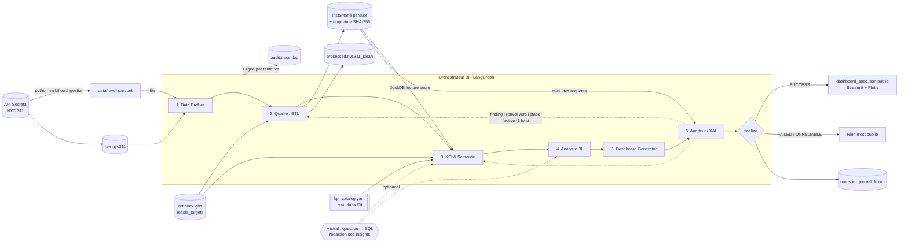

# BIFlow — pipeline BI multi-agents pour le secteur public

Projet étudiant (équipe de 6) : un pipeline BI automatisé et multi-agents, orchestré avec
**LangGraph**, appliqué aux demandes **NYC 311** (NYC Open Data, API Socrata `erm2-nwe9`).

Ce dépôt contient le **MVP complet** décrit dans l'étude d'architecture
(`BIFlow — Architecture et étude comparative des choix techniques.md`) : infra PostgreSQL, ingestion,
orchestrateur LangGraph et les 6 agents réels. Principe : **le LLM comprend et rédige, le code calcule
et vérifie**. Les KPI sont calculés par SQL à partir d'un catalogue commun, et l'Auditeur rejoue chaque
requête avant toute publication.

Le LLM est **optionnel** et **remplaçable** (`BIFLOW_LLM_PROVIDER`) : API **Mistral** (choix de l'étude) ou
modèle open-weight **local via Ollama** (ex. `qwen2.5:7b`, aucune donnée ne sort de la machine). Sans LLM, le
pipeline tourne entièrement avec la **baseline sans LLM** (règles pour question → SQL, gabarits pour les
insights). C'est aussi la référence de l'évaluation.

**Démo en une commande** (données réelles 2023-2026, puis dashboard sur <http://localhost:8501>) :

```powershell
.\scripts\demo.ps1                 # sans LLM
.\scripts\demo.ps1 -Llm ollama     # avec le modèle local
```

---

## Architecture



Fonctionnement de l'orchestrateur (`src/biflow/orchestrator/graph.py`) :

| Mécanisme | Comportement |
|---|---|
| **State partagé** | `PipelineState` (pydantic) : `run_id`, `dataset`, `outputs` par agent, `validations`, `errors`, `history`, `corrections`, `findings`, `status` |
| **Retry** | une étape qui lève une exception **ou** échoue à la validation est relancée `BIFLOW_MAX_RETRIES` fois (défaut 2) |
| **Échec** | après le dernier essai : run `FAILED`, les étapes suivantes ne s'exécutent pas, rien n'est publié |
| **Validation** | après chaque agent : schéma pydantic de la sortie + contrôles métier (`validate()`), ex. colonnes attendues, `rows_out <= rows_in`, KPI dans leur plage |
| **Boucle Auditeur** | si l'Auditeur émet un finding `error`, retour vers l'étape fautive la plus en amont (+ réexécution de l'aval), **une seule fois** (`BIFLOW_MAX_FEEDBACK_ROUNDS`). Si le problème persiste : run `UNRELIABLE`, non publié |
| **Traçabilité** | chaque tentative de chaque étape → une ligne dans `audit.trace_log`, plus une ligne `__run__` de synthèse |

Statuts finaux : `success` (publié) · `failed` · `unreliable`.

### Les agents

| Agent | Ce que fait le code | LLM (si `MISTRAL_API_KEY`) |
|---|---|---|
| **Data Profiler** | types, valeurs nulles, distributions ; défauts typés par colonne : doublon, manquant, mauvais type, format invalide, valeur invalide, hors plage, incohérence | — |
| **Qualité / ETL** | 12 règles tracées (avec le nombre de lignes concernées), minimisation RGPD (texte libre retiré, coordonnées arrondies à environ 1 km), enrichissement (délai, SLA), **instantané parquet + empreinte** ; chaque ligne supprimée est gardée en **quarantaine** avec sa règle | — |
| **KPI & Semantic** | 5 KPI et 6 ventilations du catalogue `semantic/kpi_catalog.yaml`, exécutés par DuckDB en lecture seule ; chaque requête est enregistrée (SQL, instantané, résultat) ; agrégats de moins de N demandes masqués ; **question hors périmètre** (cause, effectifs, prévision) : refus motivé, sans requête ni LLM | **question → SQL**, dans un bac à sable (SELECT seul, tables autorisées, temps et lignes limités) ; question contrôlée (données personnelles) avant envoi ; le LLM reçoit les modalités des dimensions (libellés portés par au moins N demandes) |
| **Analyste BI** | faits calculés : tendance (année contre année précédente sur un historique long), anomalies **STL + z-score robuste** (ville et chaque borough), avec le **type de plainte le plus en hausse** ce jour-là (piste, pas une cause) ; chaque insight porte ses `evidence` | **rédaction** ; un texte qui cite un nombre absent des `evidence` est rejeté (le gabarit est gardé) |
| **Dashboard** | règles de choix des graphiques → `dashboard_spec.json` (valeurs + `query_ids`) ; app Streamlit qui vérifie l'empreinte de la spec avant d'afficher ; onglets *Tableau de bord*, *Poser une question* (sur l'instantané audité, mêmes garde-fous) et *Audit et provenance* | — |
| **Auditeur / XAI** | empreinte de l'instantané, KPI affiché = résultat enregistré, **rejeu de toutes les requêtes**, recalcul indépendant en pandas, seuil, nombres des insights, empreinte et valeurs du dashboard ; explication en clair | — (c'est le code qui vérifie) |

---

## Installation

Prérequis : Python 3.11+, Docker Desktop, Git.

```powershell
# 1. Environnement Python + dépendances + fichier .env
python -m venv .venv
.\.venv\Scripts\python -m pip install -e ".[dev]"
Copy-Item .env.example .env        # puis éditer POSTGRES_PASSWORD (et SOCRATA_APP_TOKEN si vous en avez un)

# 2. Base de données (PostgreSQL 16 + Adminer) et création des tables
docker compose up -d --wait
.\.venv\Scripts\python -m biflow.db.init_db
```

Raccourcis : `make <cible>` (Linux/macOS/Git Bash avec make) ou `.\scripts\tasks.ps1 <cible>` (Windows) avec
les cibles `setup`, `up`, `down`, `init-db`, `ingest`, `ingest-small`, `run`, `test`.

**Adminer** (navigateur de la base) : <http://localhost:8081> — Système *PostgreSQL*, serveur `postgres`,
utilisateur/mot de passe/base issus de `.env`.

## Exécution

```powershell
# Ingestion : 12 derniers mois, types "Noise*" et "Street*", plafond 200 000 lignes
.\.venv\Scripts\python -m biflow.ingestion
# Extrait de test rapide
.\.venv\Scripts\python -m biflow.ingestion --max-rows 5000
# Paramètres personnalisés (un type terminé par * = préfixe)
.\.venv\Scripts\python -m biflow.ingestion --start 2026-01-01 --end 2026-03-31 `
    --complaint-types "Noise - Residential" "Street Condition" --max-rows 50000 --format csv

# Extrait déjà téléchargé en pages (ex. acquisition 2023-2026 de l'équipe) -> un fichier data/raw + fiche .meta.json
.\.venv\Scripts\python -m biflow.ingestion.import_pages <dossier raw> --name nyc311_2023-01_2026-09_echantillon `
    --source "NYC Open Data 311 (erm2-nwe9)" --note "Échantillon systématique d'environ 2 % : non probabiliste."

# Pipeline complet
.\.venv\Scripts\python -m biflow.run
.\.venv\Scripts\python -m biflow.run --start 2026-01-01 --end 2026-03-31
.\.venv\Scripts\python -m biflow.run --no-db               # sans PostgreSQL : dernier extrait de data/raw
.\.venv\Scripts\python -m biflow.run --file data/raw/extrait.parquet `
    --question "Combien de demandes de bruit à Brooklyn ?" --question "Quel borough a le plus de demandes ?"
.\.venv\Scripts\python -m biflow.run --simulate-failure quality_etl                # démo retry -> FAILED
.\.venv\Scripts\python -m biflow.run --simulate-audit-flag kpi_semantic            # démo boucle Auditeur
.\.venv\Scripts\python -m biflow.run --simulate-audit-flag kpi_semantic --persistent  # -> UNRELIABLE

# Dashboard du dernier run publié (http://localhost:8501)
.\.venv\Scripts\python -m streamlit run src/biflow/dashboard/app.py

# Évaluation du MVP sur données synthétiques (défauts et anomalie injectés) -> data/processed/evaluation/
.\.venv\Scripts\python -m biflow.evaluation

# Tests (les tests "db" utilisent la base biflow_test, créée automatiquement ; ignorés sans PostgreSQL)
.\.venv\Scripts\python -m pytest
```

Chaque run écrit ses artefacts dans `data/processed/<run_id>/` : instantané `nyc311_clean.parquet`,
`dashboard_spec.json` et `run.json` (state complet : sorties, requêtes et résultats, contrôles, findings).
`data/processed/published.json` pointe vers le dernier run **publié** : c'est le seul que le dashboard affiche.

### Évaluation (seed 42)

`python -m biflow.evaluation` (baseline) ; `BIFLOW_LLM_PROVIDER=ollama` pour la mesure avec le LLM local.

| Critère | Baseline sans LLM | LLM local qwen2.5:7b | Objectif |
|---|---|---|---|
| Défauts injectés détectés par le Profiler | 9/9 types, 100 % | 100 % | ≥ 95 % |
| SQL correct, 51 questions | 61 % | **88 %** | ≥ 80 % |
| … 30 questions « catalogue » | 100 % | 97 % | — |
| … 21 reformulations libres | 5 % | **76 %** | — |
| KPI = calcul manuel sur la vérité terrain | 5/5 | 5/5 | tous |
| Anomalie injectée (bonne zone, bon jour) | 100 %, 0 faux positif | idem | ≥ 80 % |
| Insights avec un nombre non justifié | 0 | 0 | 0 |
| Écarts volontaires détectés par l'Auditeur | 4/4 (run `unreliable`, non publié) | 4/4 | tous |
| Questions hors périmètre refusées | 3/3, 0 refus à tort | 3/3 | — |
| Temps par question | ~0,004 s | ~2,2 s | mesurer |

**Contrôle croisé** : chaque réponse du LLM est comparée à celle de la baseline quand celle-ci reconnaît la
question. Réponses concordantes : 25/25 justes ; divergentes : 15/19 justes. Le dashboard signale les
divergences (« réponse à vérifier »).

Réserves : les questions « catalogue » suivent les formulations prévues par les règles de la baseline (son
100 % est optimiste) ; quelques règles générales du prompt ont été ajoutées après une première mesure sur
ces mêmes questions (le 88 % est légèrement optimiste). La comparaison avec Mistral reste à faire
(`MISTRAL_API_KEY`).

### Données réelles

Extrait de l'équipe : 265 609 demandes, janvier 2023 à septembre 2026 (échantillon systématique d'environ 2 %
par mois et par borough, non probabiliste). Run complet en environ 10 s, 53/53 contrôles d'audit. Anomalies
détectées : 2026-02-24 (*Snow or Ice*), 2023-09-29 (*Sewer Maintenance*, inondations de New York)... avec le
type de plainte en hausse présenté comme une piste, pas comme une cause. Déroulé de démonstration :
`docs/DEMO.md`.

### Configuration du LLM et de la sécurité (`.env`)

| Variable | Rôle | Défaut |
|---|---|---|
| `BIFLOW_LLM_PROVIDER` | `auto` (Mistral si clé, sinon aucun), `mistral`, `ollama`, `none` | `auto` |
| `MISTRAL_API_KEY` / `MISTRAL_MODEL` | API Mistral | vide / `mistral-small-latest` |
| `OLLAMA_MODEL` / `OLLAMA_BASE_URL` | modèle local (`ollama pull qwen2.5:7b`) | `qwen2.5:7b` / `http://localhost:11434/v1` |
| `BIFLOW_MIN_GROUP_SIZE` | seuil anti-identification (à fixer avec le DPO) | 10 |
| `BIFLOW_SQL_MAX_ROWS` / `BIFLOW_SQL_TIMEOUT_SECONDS` | limites du SQL généré | 1000 / 10 |

Ce qui est envoyé au LLM : la question contrôlée (email, téléphone, adresse, n° de demande masqués), le
schéma, les définitions des KPI et, pour la rédaction, les `evidence` (agrégats après seuil). **Jamais**
de ligne brute ni de champ texte du jeu de données.

L'ingestion est **rejouable** : upsert sur `unique_key` (une demande déjà présente est mise à jour, par
exemple quand elle passe de *Open* à *Closed*).

## Base de données

| Table | Contenu |
|---|---|
| `raw.nyc311` | demandes brutes (`unique_key` PK, `created_date`, `closed_date`, `agency`, `complaint_type`, `descriptor`, `incident_zip`, `borough`, `status`, `resolution_description`, `latitude`, `longitude`, `ingested_at`) |
| `ref.boroughs` | 5 boroughs ; `population` du recensement 2020 (US Census Bureau), complétée par `init_db` si vide |
| `ref.sla_targets` | délai cible (heures) par `complaint_type` — **valeurs PLACEHOLDER** (`is_placeholder = true`, note *TO BE DEFINED*) |
| `audit.trace_log` | une ligne par tentative d'étape : `run_id`, `step`, `attempt`, `status`, `started_at`, `ended_at`, `input_rows`, `output_rows`, `message`, `details` (JSONB) |
| `processed.nyc311_clean` | couche propre du dernier run lu depuis PostgreSQL (écrite par Qualité/ETL) |

Le schéma est défini dans `src/biflow/db/models.py` (source de vérité) ; `init_db` est idempotent.
Les dates NYC 311 sont en heure locale de New York (timestamps sans fuseau).

## Structure

```
biflow/
├── docker-compose.yml        PostgreSQL 16 + Adminer
├── pyproject.toml / requirements.txt
├── Makefile, scripts/tasks.ps1
├── .env.example
├── data/{raw,processed,test}/  (ignoré par git)
├── docs/SUMMARY.md
├── notebooks/
├── src/biflow/
│   ├── run.py                CLI : python -m biflow.run
│   ├── common/               config (.env), logging, schéma, load_raw_frame(), référentiels, instantanés
│   ├── db/                   engine, models (schéma), init_db, loader (upsert)
│   ├── ingestion/            client Socrata + CLI (python -m biflow.ingestion), import de pages
│   ├── orchestrator/         state, graph (LangGraph), validation, tracing, report
│   ├── agents/               base.py + 1 fichier par agent + testing.py
│   ├── semantic/             kpi_catalog.yaml, bac à sable SQL (DuckDB), question -> SQL, périmètre
│   ├── analysis/             STL + z-score, vérification des nombres cités
│   ├── llm/                  client LLM (Mistral ou Ollama), contrôle des données personnelles
│   ├── dashboard/            app.py (Streamlit + Plotly)
│   └── evaluation/           jeu synthétique + python -m biflow.evaluation
└── tests/
```

---

## Pour les coéquipiers

### Qui modifie quoi

| Agent | Fichier à modifier | Lit dans le state | Produit (`outputs[...]`) |
|---|---|---|---|
| Data Profiler | `src/biflow/agents/data_profiler.py` | `dataset` | `ProfilerOutput` |
| Qualité / ETL | `src/biflow/agents/quality_etl.py` | `dataset`, `outputs["data_profiler"]` | `QualityOutput` (+ table `processed.*`) |
| KPI & Semantic | `src/biflow/agents/kpi_semantic.py` | `outputs["quality_etl"]` | `KPIOutput` |
| Analyste BI | `src/biflow/agents/analyste_bi.py` | `outputs["kpi_semantic"]` | `AnalysisOutput` |
| Dashboard Generator | `src/biflow/agents/dashboard_generator.py` | `outputs["kpi_semantic"]`, `outputs["analyste_bi"]` | `DashboardOutput` |
| Auditeur / XAI | `src/biflow/agents/auditor_xai.py` | tout le state + `audit.trace_log` | `AuditOutput` (+ `findings`) |

Chaque fichier commence par une docstring qui décrit ce que fait l'agent : partez de cette version
du MVP pour l'améliorer.

### Le contrat d'un agent

```python
class KPISemanticAgent(BaseAgent):
    name = "kpi_semantic"            # NE PAS CHANGER : clé du state, nom du nœud, step dans trace_log
    output_model = KPIOutput         # modèle pydantic de sortie = contrat avec les agents suivants

    def run(self, state: PipelineState) -> KPIOutput:
        etl = state.output("quality_etl")          # sortie de l'étape précédente (dict)
        ...                                        # votre logique
        return KPIOutput(kpis=[...], input_rows=..., output_rows=...)

    def validate(self, output: KPIOutput, state: PipelineState) -> list[Check]:
        return [check_in_range("kpi:x", output.kpis[0].value, 0, 100)]   # contrôles métier
```

Règles :

1. **Ne modifiez pas le state** : retournez seulement votre objet de sortie, l'orchestrateur l'enregistre
   dans `state.outputs[name]` (en dict JSON).
2. **En cas d'erreur, levez une exception** : pas de `try/except` qui avale l'erreur. L'orchestrateur
   relance l'étape, puis marque le run `FAILED`.
3. **Ne mettez pas de DataFrame dans la sortie** : uniquement des valeurs JSON-sérialisables. Les gros
   volumes vont en base (schéma `processed`) et vous renvoyez le nom de la table.
4. **Vous pouvez ajouter des champs** à votre modèle de sortie ; pour **renommer/supprimer** un champ,
   prévenez les agents qui le lisent (tableau ci-dessus).
5. `is_stub` vaut `False` par défaut : les 6 agents sont réels, le résumé n'affiche plus `[stub]`.
6. Si l'Auditeur vous renvoie une correction, elle est dans `state.corrections.get(self.name)` : votre
   agent doit en tenir compte lors de sa réexécution.

Champs communs (`AgentOutput`) : `input_rows`, `output_rows` (repris dans `audit.trace_log`), `notes`
(texte libre, repris dans `message`), `is_stub`.

### Lire les données

```python
from biflow.common.data import load_raw_frame
df = load_raw_frame(state.dataset)          # raw.nyc311 filtré sur la fenêtre de dates du run
from biflow.common.snapshot import read_snapshot   # après Qualité/ETL : données propres du run
clean = read_snapshot(state.output("quality_etl")["snapshot_path"])
from biflow.semantic.sandbox import SQLSandbox     # SQL en lecture seule sur l'instantané
from biflow.db.engine import get_engine     # pour lire/écrire d'autres tables (SQLAlchemy)
```

### Le logging : rien à faire

`BaseAgent.execute()` écrit automatiquement dans `audit.trace_log`, pour chaque tentative :
statut (`success` / `retry` / `failed`), horodatages, `input_rows` / `output_rows`, `notes`, et dans
`details` : résultats de validation, traceback en cas d'erreur, tour de rétroaction, correction appliquée.
Pour vos logs de debug, utilisez `logging.getLogger(__name__)`.

```sql
SELECT step, attempt, status, input_rows, output_rows, message
FROM audit.trace_log WHERE run_id = '<run_id affiché par biflow.run>' ORDER BY id;
```

### Tester votre agent

```powershell
.\.venv\Scripts\python -m biflow.run                  # tout le pipeline avec votre agent
.\.venv\Scripts\python -m pytest                      # ne doit rien casser
```

Ajoutez vos tests dans `tests/test_<agent>.py`. La fixture `ctx` (`tests/conftest.py`) fournit un
contexte sans délai de retry avec une trace en mémoire ; `clean_db` fournit une base de test vide.

### Workflow Git

Une branche par agent (`feat/kpi-semantic`…), pull request vers `main`, `pytest` vert avant merge.
Ne committez jamais `.env` ni `data/`.
